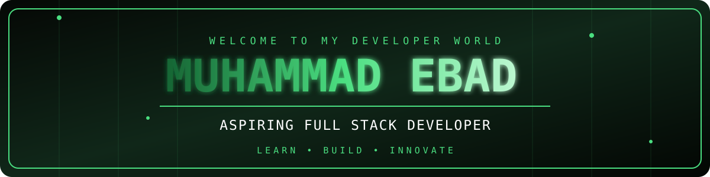

 

**LEARN • BUILD • CREATE • INNOVATE**

---

## 👨‍💻 About Me

Hi! I'm **Muhammad Ebad**, a passionate web development student who loves creating modern websites and learning new technologies.

- 🎓 Web Development Student at **SMIT (Saylani Mass IT Training)**
- ✅ Completed HTML5
- 🌱 Currently learning CSS3 and Responsive Design
- 🚀 Next Goal: JavaScript and React.js
- 💻 Interested in Frontend and Full Stack Development
- 🎯 Dream: Become a Professional MERN Stack Developer

---

## 🛠️ Tech Stack & Tools

---

## 📚 My Learning Journey

| Technology | Status |
|:---|:---|
| HTML5 | ✅ Completed |
| CSS3 | 🟢 Learning |
| Responsive Design | 🟢 Learning |
| Bootstrap | 🟢 Practicing |
| JavaScript | ⏳ Upcoming |
| React.js | 🎯 Future Goal |
| Node.js | 🎯 Future Goal |
| MongoDB | 🎯 Future Goal |

---

## 🚀 Featured Projects

### 🌐 Landing Page With HTML & CSS

A frontend landing page project created using HTML5 and CSS3.

---

## 📊 GitHub Statistics

---

## 🔥 GitHub Contribution Streak

---

## 🎯 My Future Goals

- [ ] Master HTML5 and CSS3
- [ ] Learn JavaScript
- [ ] Build responsive websites
- [ ] Learn React.js
- [ ] Learn Node.js and Express.js
- [ ] Learn MongoDB
- [ ] Build Full Stack MERN Projects

---

## 💡 My Developer Mindset

### LEARN → PRACTICE → BUILD → DEPLOY → GROW

*"Consistency is the key to becoming a better developer."*

---

### 💚 Thanks for Visiting My Profile!

**Keep Learning. Keep Coding. Keep Growing.**

